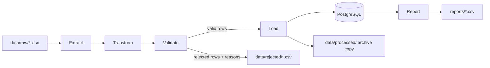

# Automated Sales Data Pipeline

[](https://github.com/aaronGeb/automated-sales-data-pipeline/actions/workflows/ci.yml)
A Python ETL pipeline that ingests a retail sales Excel export, validates every row against an explicit data contract, quarantines bad rows with reasons, loads clean data into PostgreSQL idempotently, and generates analytics reports.

On a 541,909-row workbook it runs end to end in about 27 seconds (most of it reading the `.xlsx`). The load itself takes about 12 seconds.

## Architecture



| Stage      | Module                    | What it does                                                                                                                             |
| ---------- | ------------------------- | ---------------------------------------------------------------------------------------------------------------------------------------- |
| Extract    | `extract/excel_reader.py` | Reads everything as text, normalizes headers, drops blank rows, tags each row with `source_file` and `source_row` (its Excel row number) |
| Transform  | `transform/cleaning.py`   | Casts types (bad values become NA, never a crash), adds `is_cancellation` and `is_non_product` flags. Never drops rows                   |
| Validate   | `validate/rules.py`       | Applies the contract in `config/schemas/sales_schema.yaml` plus business rules; every rejected row records all its reasons               |
| Quarantine | `validate/quarantine.py`  | Writes rejected rows and reasons to `data/rejected/`                                                                                     |
| Load       | `load/loader.py`          | `COPY` into a temp table, then `INSERT ... ON CONFLICT DO NOTHING` in one transaction                                                    |
| Report     | `report/generator.py`     | Runs each `sql/analytics/*.sql` file and writes a CSV to `reports/`                                                                      |

## Quickstart

Requires [uv](https://docs.astral.sh/uv/), Docker, and Python 3.11.

```bash
uv sync
cp .env.example .env              # set a password; keep DATABASE_URL in sync
docker compose up -d              # PostgreSQL, schema created on first start
# put the source workbook at data/raw/Online Retail.xlsx (not included in the repo)
uv run sales-pipeline run "data/raw/Online Retail.xlsx"
```

Run it fully containerized instead:

```bash
docker compose build pipeline
docker compose run --rm pipeline run "data/raw/Online Retail.xlsx"
```

Other commands:

```bash
uv run sales-pipeline report      # regenerate reports from the database
make test                         # pytest (needs the database running)
make lint                         # ruff + mypy
```

Exit codes: `0` success, `1` expected pipeline failure (extract/load), `2` bad arguments or an unexpected error.

## Validation rules

| Reject reason                        | Rule                                                            |
| ------------------------------------ | --------------------------------------------------------------- |
| `missing_or_invalid_<column>`        | A non-nullable column in the schema is empty or failed to parse |
| `invalid_invoice_no`                 | Invoice number doesn't match `^[CA]?\d{6}$`                     |
| `accounting_adjustment`              | Invoice starts with `A` (bad-debt adjustments, not sales)       |
| `zero_quantity`                      | Quantity is 0                                                   |
| `negative_quantity_not_cancellation` | Negative quantity on an invoice that isn't a `C` cancellation   |
| `positive_quantity_on_cancellation`  | Positive quantity on a `C` cancellation                         |
| `non_positive_unit_price`            | Unit price is 0 or negative                                     |
| `future_invoice_date`                | Invoice date is in the future                                   |
| `duplicate_row`                      | Exact repeat of an earlier row (first one is kept)              |

Rows are **kept and flagged**, not rejected, when they are valid business events:

- `is_cancellation`: invoices starting with `C` (negative quantities), so net revenue can be computed
- `is_non_product`: stock codes that aren't products (postage, fees, vouchers), excluded from the top-products report
- Missing `Description` and missing `CustomerID` (guest checkouts) are allowed

## Results on the sample file

|               | Rows    |
| ------------- | ------- |
| Extracted     | 541,909 |
| Valid, loaded | 534,128 |
| Rejected      | 7,781   |

Rejections: 5,268 duplicates, 2,517 non-positive prices (1,336 of them also negative-quantity stock write-offs), 3 accounting adjustments. Rows can fail more than one rule, so some are counted in both.

Reports written to `reports/`: `daily_sales.csv`, `top_products.csv`, `regional_summary.csv`. The United Kingdom accounts for about 8.18M of net revenue (currency is not stated in the data; assumed GBP), far ahead of the next country.

## Idempotency

Each row gets a `row_hash` (SHA-256 over the business columns) as the primary key, and the load uses `ON CONFLICT DO NOTHING`. Re-running the same file inserts 0 rows: on the sample file the second run reports `0 inserted, 534128 already present`. The load is a single transaction, so a failure commits nothing, and the source file is only archived to `data/processed/` after everything succeeds. `data/raw/` is never modified.

## Data quality decisions

- **Zero-price rows are rejected.** The 1,174 rows rejected only for a zero price carry no revenue, mostly lack a description (6 of 8 in a random sample), and only 40 have a customer ID. They look like stock adjustments rather than sales. Keeping them would inflate unit counts without changing revenue. They are preserved in `data/rejected/`, so the rule is reversible.
- **Exact duplicates are treated as errors.** If two identical lines on one invoice were genuinely scanned twice, they would be collapsed to one. For this dataset that is the safer default, but it is a judgment call.
- **Corrections create new rows.** Because the key is a hash of the row's values, a corrected version of an existing row loads as a new row. It does not update the old one.
- **Revenue per customer is not reported.** Net revenue includes guest checkouts with no customer ID, so dividing it by distinct customers would overstate the figure.

## Project layout

```text
src/pipeline/      extract/ transform/ validate/ load/ report/, config.py, main.py (CLI)
config/schemas/    data contract (sales_schema.yaml)
sql/ddl/           table and index definitions, run on first container start
sql/analytics/     one .sql file per report
tests/             unit/ and integration/ (integration needs PostgreSQL)
```
